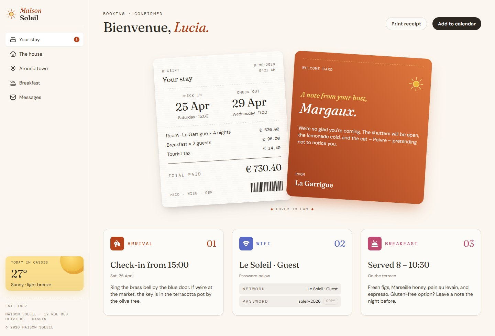
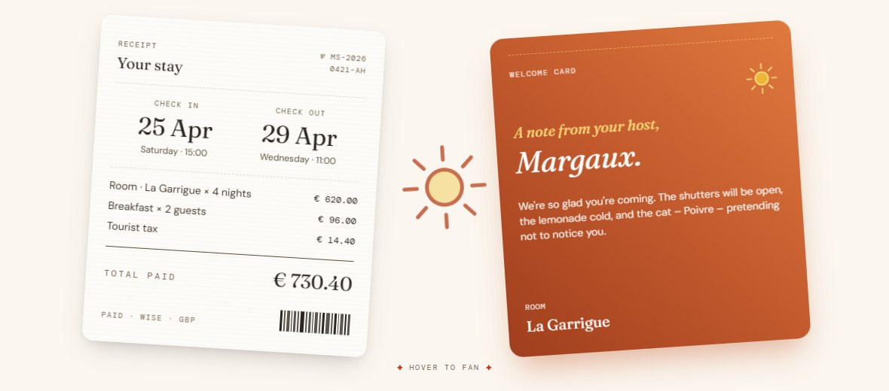
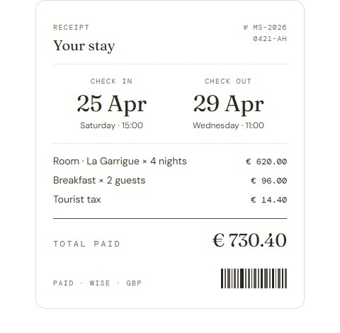
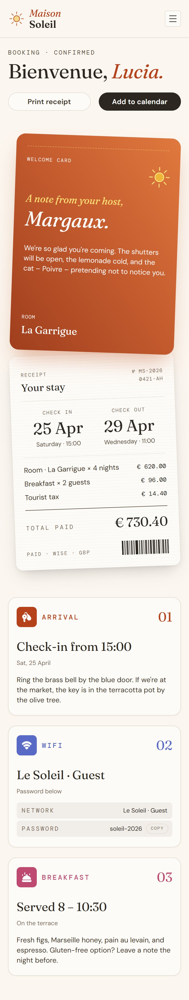
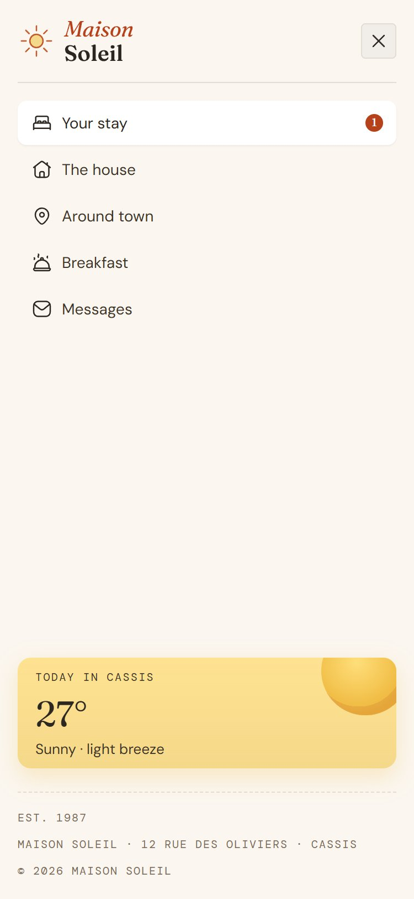

<div align="center">

# Maison Soleil — Hotel Booking Confirmation

A responsive, accessible booking confirmation page for a small guest house in Cassis, built as a solution to the [Frontend Mentor](https://www.frontendmentor.io) *Hotel booking confirmation page* challenge.

[](https://alexisg1993.github.io/hotel-booking-confirmation-page/)
[](https://tailwindcss.com)
[](#getting-started)
[](./LICENSE)

**[View live site](https://alexisg1993.github.io/hotel-booking-confirmation-page/)** · [Challenge brief](./docs/challenge-brief.md) · [Style guide](./docs/style-guide.md)



</div>

---

## Table of contents

- [Features](#features)
- [Screenshots](#screenshots)
- [Built with](#built-with)
- [Getting started](#getting-started)
- [Project structure](#project-structure)
- [Implementation notes](#implementation-notes)
- [Accessibility](#accessibility)
- [Responsive behaviour](#responsive-behaviour)
- [Roadmap](#roadmap)
- [Acknowledgements](#acknowledgements)
- [License](#license)

## Features

| Feature | Details |
| --- | --- |
| **Responsive layout** | Mobile-first, tested from 320px to 1920px with no horizontal scroll. |
| **Hover-to-fan cards** | The receipt and welcome card swing apart on hover *or* keyboard focus, revealing a sun illustration. Pure CSS transforms and transitions. |
| **Mobile navigation** | The sidebar collapses into a full-screen toggle menu with focus management and <kbd>Esc</kbd> to close. |
| **Copy Wi-Fi password** | One-click copy via the Clipboard API, with visual and screen-reader feedback. |
| **Print receipt** | A dedicated `@media print` view prints only the receipt, flat and centred on white. |
| **Add to calendar** | Generates an iCalendar (`.ics`) file from the stay dates in the browser. Works with Outlook, Google Calendar and Apple Calendar. |
| **Interaction states** | Hover and visible focus states on every link and button. |
| **Reduced motion** | Animations are disabled when the user prefers reduced motion. |

## Screenshots

<table>
  <tr>
    <td width="62%"></td>
    <td></td>
  </tr>
  <tr>
    <td align="center"><sub>Cards fanned out on hover</sub></td>
    <td align="center"><sub>Print view</sub></td>
  </tr>
</table>

<table>
  <tr>
    <td width="50%"></td>
    <td></td>
  </tr>
  <tr>
    <td align="center"><sub>Mobile (375px)</sub></td>
    <td align="center"><sub>Mobile menu</sub></td>
  </tr>
</table>

## Built with

- Semantic **HTML5**
- **[Tailwind CSS](https://tailwindcss.com)** (Play CDN), with the style guide's colour tokens and font families mapped into the theme config
- A small amount of custom **CSS** for the card fan, receipt paper texture and print styles
- Vanilla **JavaScript**: no frameworks or dependencies
- Self-hosted variable fonts: **Fraunces**, **DM Sans** and **DM Mono**

## Getting started

There is no build step. Clone the repo and open the page:

```bash
git clone https://github.com/AlexisG1993/hotel-booking-confirmation-page.git
cd hotel-booking-confirmation-page
```

Then either open `index.html` directly in a browser, or serve it locally (recommended, since the Clipboard API requires a secure context):

```bash
npx serve .
# or
python -m http.server 8000
```

> [!NOTE]
> Styles are generated at runtime by the Tailwind Play CDN, so an internet connection is required on first load.

## Project structure

```
.
├── index.html            # The page: markup, Tailwind config, custom CSS and JS
├── assets/
│   ├── fonts/            # Fraunces, DM Sans, DM Mono (OFL-licensed)
│   └── images/           # Logo, icons and illustrations (SVG)
├── design/               # Reference designs from Frontend Mentor
├── docs/
│   ├── challenge-brief.md
│   └── style-guide.md
└── screenshots/          # Images used in this README
```

## Implementation notes

### Hover-to-fan cards

Both cards are laid out side by side in a flex container, then repositioned with `transform` only, so the animation never triggers layout. The fan state applies on both `:hover` and `:focus-within`, which makes it reachable by keyboard. Below 1024px a separate media query uses smaller offsets so the cards never leave the viewport.

```css
.fan:hover .card-receipt,
.fan:focus-within .card-receipt { transform: translate(-90px, -10px) rotate(4.3deg); }
```

### Print view

Instead of `visibility: hidden` (which still reserves space and can produce blank pages), every element except the receipt is removed with `display: none`. The receipt's rotation, shadow and transition are reset so it prints flat.

### Calendar file

The `.ics` file is assembled as an RFC 5545 string with CRLF line endings and downloaded through a `Blob` URL. Check-in and check-out are local Cassis times (CEST, UTC+2) stored as UTC, so the event appears at the correct local time in any calendar app.

| | Local (Cassis) | Stored (UTC) |
| --- | --- | --- |
| Check-in | Sat 25 Apr 2026, 15:00 | `20260425T130000Z` |
| Check-out | Wed 29 Apr 2026, 11:00 | `20260429T090000Z` |

### Design fidelity

The build was checked against the reference JPGs with Puppeteer screenshots over several rounds, adjusting spacing, type sizes and card geometry until it matched to within ~3px at 375px and 1440px.

## Accessibility

- Landmarks (`header`, `nav`, `main`, `aside`) and a logical heading order
- `aria-current="page"` on the active navigation item
- Menu toggle uses `aria-expanded` / `aria-controls`; focus moves into the menu on open and back to the toggle on close
- Copy feedback is announced through an `aria-live="polite"` region
- Decorative images use empty `alt` text; icon-only buttons have visually hidden labels
- Visible `:focus-visible` outlines on all interactive elements
- Respects `prefers-reduced-motion`

## Responsive behaviour

| Breakpoint | Layout |
| --- | --- |
| `< 768px` | Top bar with menu toggle; cards stacked, welcome card first; info cards in one column |
| `≥ 768px` | Receipt and welcome card overlap side by side; "Hover to fan" hint appears |
| `≥ 1024px` | Arrival, Wi-Fi and Breakfast cards in a three-column row |
| `≥ 1280px` | Persistent sidebar navigation replaces the top bar |

## Roadmap

- [ ] Replace the Tailwind Play CDN with a compiled, purged stylesheet
- [ ] Load booking details from a JSON file so the page and calendar export share one data source
- [ ] Trap focus inside the open mobile menu and mark background content `inert`
- [ ] Fold long `.ics` lines to 75 octets per RFC 5545

## Acknowledgements

- Challenge, designs and assets by [Frontend Mentor](https://www.frontendmentor.io)
- Typefaces: [Fraunces](https://fonts.google.com/specimen/Fraunces), [DM Sans](https://fonts.google.com/specimen/DM+Sans) and [DM Mono](https://fonts.google.com/specimen/DM+Mono), licensed under the SIL Open Font License

## Author

**AlexisG1993** — [GitHub](https://github.com/AlexisG1993)

## License

The source code in this repository is released under the [MIT License](./LICENSE).
Designs, images and the challenge brief are © Frontend Mentor and are included for reference only. Fonts are distributed under the SIL Open Font License (see `assets/fonts/*/OFL.txt`).
